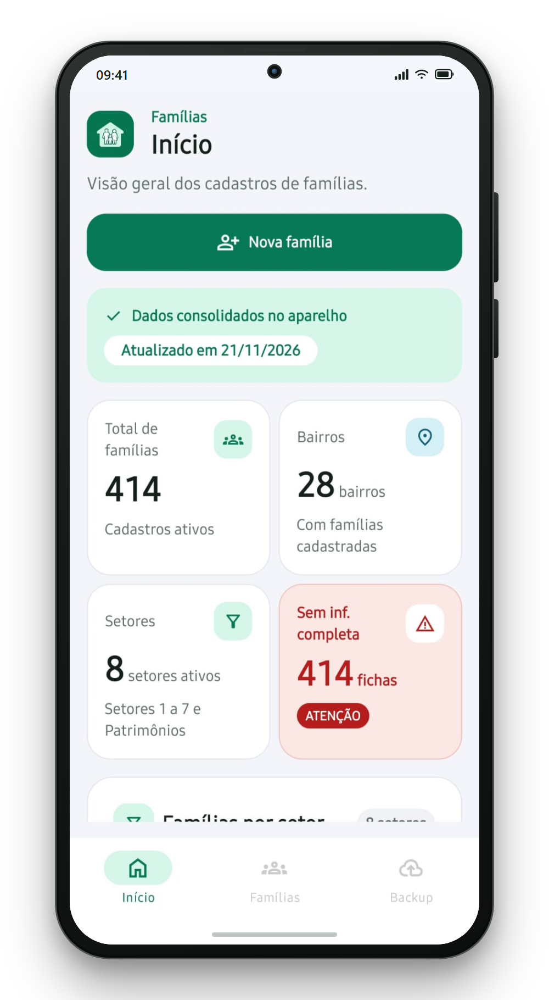

<div align="center">
  

  <h1>Famílias — Gerenciamento Mobile</h1>

  <p><strong>Organize cadastros familiares, visitas, setores e rotas offline direto no celular.</strong></p>

  <p>Aplicativo Android-first desenvolvido com Expo, React Native, TypeScript e SQLite para substituir planilhas Excel manuais por uma interface simples, legível e totalmente funcional sem internet.</p>

  <p>
    
    
    
    
    
    
  </p>

  <p>
    <a href="#-sobre-o-projeto">Sobre</a> &bull;
    <a href="#-funcionalidades">Funcionalidades</a> &bull;
    <a href="#-tecnologias-utilizadas">Tecnologias</a> &bull;
    <a href="#-como-executar">Como executar</a> &bull;
    <a href="#-regras-de-validação">Validação</a> &bull;
    <a href="#-persistência-dos-dados">Dados</a> &bull;
    <a href="#-estrutura-do-projeto">Estrutura</a> &bull;
    <a href="#-autor">Autor</a>
  </p>
</div>

---

<p align="center">
  
</p>

## 📍 Sobre o projeto

O **Famílias** (`GerenciamentoDeFamiliasMobile`) é um aplicativo mobile criado para substituir o controle de cadastros feito anteriormente em planilhas Excel (como registros por setores em arquivos `.xlsx`) por uma experiência prática no dia a dia.

Projetado especialmente para uso cotidiano por uma pessoa não técnica, o aplicativo prioriza textos grandes, alto contraste, botões amplos e fluxos diretos em poucos toques. Todos os dados são salvos localmente no aparelho com **SQLite**, sem necessidade de login, servidor ou sincronização em nuvem.

### Objetivos

- Substituir planilhas manuais por um cadastro rápido e estruturado no celular;
- funcionar **100% offline** nos fluxos de consulta, cadastro, edição, visitas e geração de backups (dependendo de internet apenas para consulta de CEP online e abertura externa do Google Maps/Waze);
- identificar automaticamente o **setor** (`Setor 1` a `Setor 7` e `Patrimônios`) a partir do bairro ou distrito;
- alertar sobre cadastros com campos pendentes e visitas realizadas há mais de 6 meses;
- garantir portabilidade segura dos dados por meio de planilhas `.xlsx` com pré-visualização antes de importar.

## ✨ Funcionalidades

### Painel inicial (Início)

- Botão de destaque **`+ Nova família`** para cadastro imediato;
- indicador de consolidação local com a data da última atualização dos registros;
- cards de KPI com total de famílias, quantidade de bairros, setores ativos e alerta de fichas com informações incompletas;
- resumo demográfico consolidado (moradores, crianças, idosos, enfermos e batizados);
- gráficos/barras de distribuição por **setor**, **localidade/distrito**, **principais bairros**, **situação religiosa**, **situação econômica** e **tipo de residência**;
- atualização manual com gesto *pull-to-refresh*.

### Listagem, busca e filtros (Famílias)

- Busca instantânea com *debounce* que ignora maiúsculas, minúsculas e acentuação;
- filtros combináveis por **Setor**, **Localidade / distrito**, **Bairro**, **Situação religiosa**, **Status de visita** (`Há mais de 6 meses`, `Visita não informada`, `Visita realizada`) e **Completude dos dados**;
- filtro rápido para listar apenas famílias com pessoas enfermas;
- preservação automática da busca e dos filtros aplicados ao retornar das telas de detalhes ou edição.

### Cadastro, detalhes, visitas e rotas

- Formulário único reutilizado para **criação** e **edição**, com validação por campo;
- preenchimento assistido de bairros já existentes para evitar variações de escrita;
- consulta opcional de CEP e pesquisa de CEP por logradouro em **Cândido Mota/SP** via **ViaCEP**, com cache offline em SQLite (`ceps_cache`);
- suporte a **múltiplos cargos simultâneos** (`familia_cargos`) de forma independente do **ministério**;
- registro rápido de **última visita** diretamente na tela de detalhes (com atalhos de data e confirmação);
- exclusão segura protegida por modal de confirmação;
- abertura direta do endereço no **Google Maps** ou **Waze** (com bloqueio automático e aviso de *Endereço incompleto* quando faltam informações mínimas).

### Backup e planilhas (Backup)

- Exportação offline para planilha `.xlsx` com duas abas: **`Familias`** (dados completos) e **`LEIAME`** (guia das colunas e valores permitidos);
- compartilhamento nativo do arquivo gerado (WhatsApp, Google Drive, e-mail ou armazenamento local);
- registro da data e hora do último backup exportado;
- importação inteligente com **pré-visualização obrigatória**, separando novos cadastros, atualizações por `id` (sem duplicar famílias) e linhas inválidas com motivo detalhado;
- compatibilidade com aliases de cabeçalhos e importação de planilhas legadas.

## 🛠️ Tecnologias utilizadas

| Tecnologia | Utilização |
| --- | --- |
| **Expo (SDK 58)** | Plataforma de build, runtime nativo e módulos do sistema |
| **Expo Router** | Roteamento baseado em arquivos (`src/app/`) com abas nativas (`NativeTabs`) |
| **React Native & React** | Interface mobile nativa Android-first com suporte multiplataforma |
| **TypeScript** | Tipagem estrita de domínio, formulários, validações e consultas |
| **Expo SQLite (`expo-sqlite`)** | Banco relacional local offline com migrações versionadas (`PRAGMA user_version`) |
| **SheetJS (`xlsx`)** | Geração e leitura de planilhas `.xlsx` diretamente no dispositivo |
| **Expo File System, Document Picker & Sharing** | Seleção, gravação temporária e compartilhamento de arquivos de backup |
| **Expo Crypto** | Geração de UUIDs estáveis para identificação única das famílias |
| **ViaCEP API + SQLite Cache** | Busca opcional de endereço/CEP em Cândido Mota/SP com reaproveitamento offline |
| **React Native Linking** | Abertura de rotas externas no Google Maps e Waze |
| **EAS Build** | Geração de builds Android (APK interno e produção) com incremento automático |

## 🚀 Como executar

### Pré-requisitos

- [Node.js](https://nodejs.org/) (LTS recomendado) e `npm`;
- [Git](https://git-scm.com/) para clonar o repositório;
- **Expo Go** no Android, emulador Android configurado ou build de desenvolvimento EAS.

### 1. Clone o repositório

```bash
git clone https://github.com/DarioKlein/gerenciador-de-familias-react-native.git
cd gerenciador-de-familias-react-native
```

### 2. Instale as dependências

```bash
npm install
```

### 3. Inicie o servidor de desenvolvimento

```bash
npx expo start
```

> Para abrir diretamente no emulador ou dispositivo Android conectado via USB, utilize `npm run android`.

### 4. Verificações e build Android (EAS)

Checagem de tipos e lint:

```bash
npx tsc --noEmit
npm run lint
```

Geração de APK Android para testes internos via EAS:

```bash
npx eas-cli build --platform android --profile preview
```

## 🧩 Como o projeto funciona

As telas e navegadores ficam isolados em `src/app/`, enquanto regras de negócio, acesso ao SQLite, validações e serviços ficam desacoplados em `src/database/` e `src/features/familias/`:

```text
src/app/ (_layout.tsx + NativeTabs)
  ├── Início (index.tsx)          ──► dashboard.ts (KPIs e agregações)
  ├── Famílias (familias/)        ──► use-familias-repository.ts ──► SQLite (familias.db)
  │     ├── Nova / Editar         ──► validation.ts + cep.ts (ViaCEP / ceps_cache)
  │     └── Detalhes ([id])       ──► visita.ts + mapa.ts (Google Maps / Waze)
  └── Backup (backup.tsx)         ──► backup-xlsx.ts + backup-file-service.ts
```

## 🧪 Regras de validação

| Campo | Regra |
| --- | --- |
| **Nome** (`nome`) | Obrigatório; espaços extras são normalizados |
| **Endereço** (`endereco`) | Obrigatório (rua ou avenida, sem o número) |
| **CEP** (`cep`) | Opcional; quando informado, exige exatamente 8 dígitos (formato `00000-000`) |
| **Telefone** (`telefone`) | Opcional; armazenado como texto, aceita até 11 dígitos numéricos |
| **Localidade / distrito** (`cidade`) | Opcional; valores fixos: `Cândido Mota`, `Alexandria`, `Porto Almeida`, `Frutal do Campo`, `Guaripu` |
| **Cargos** (`cargos`) | Múltipla escolha opcional (`Auxiliar de jovens`, `Administração`, `Porteiro(a)`, `Músico`, `Organista`, `Auxiliar do som`) |
| **Ministério** (`ministerio`) | Escolha única opcional, independente dos cargos (`Ancião`, `Diácono`, `Cooperador oficial`, `Cooperador de jovens`, `Irmã da obra da piedade`, `Encarregado de orquestra`) |
| **Situação religiosa** | Escolha única opcional: `Congrega` ou `Parado` |
| **Situação econômica** | Escolha única opcional: `Aposentado`, `Desempregado`, `Registrado`, `Encostado` ou `Autônomo` |
| **Tipo de residência** | Escolha única opcional: `Própria` ou `Alugada` |
| **Contagens de moradores** | Opcionais; números inteiros de `0` a `999` (moradores, crianças, idosos, enfermos e batizados) |
| **Última visita** (`ultima_visita`) | Opcional; data válida (`DD/MM/AAAA` ou `AAAA-MM-DD`) e não pode ser futura |

## 💾 Persistência dos dados

O banco local (`familias.db`) utiliza **SQLite** em modo `WAL` com integridade referencial ativada (`PRAGMA foreign_keys = ON`) e controle de esquema versionado via `PRAGMA user_version` (atualmente na **versão 7**):

| Tabela | Finalidade |
| --- | --- |
| `familias` | Cadastro principal das famílias, endereço, contagens, situações, última visita e timestamps ISO 8601 |
| `familia_cargos` | Relação N:N entre família e múltiplos cargos com remoção em cascata (`ON DELETE CASCADE`) |
| `ceps_cache` | Cache local das consultas bem-sucedidas ao ViaCEP para reaproveitamento offline |

> [!IMPORTANT]
> Todos os dados ficam armazenados **exclusivamente no aparelho**. Caso o aplicativo seja desinstalado ou os dados do app sejam apagados nas configurações do Android, o banco local é removido. Utilize regularmente a aba **Backup** para exportar e guardar a planilha `.xlsx` em local seguro.

## 🎨 Identidade visual

Os tokens de cores do tema claro estão centralizados em `src/constants/theme.ts`:

| Token | Hexadecimal | Uso principal |
| --- | --- | --- |
| `primary` | `#087A57` | Botões principais, abas ativas, ícone e destaques |
| `primarySoft` | `#D8F7EB` | Fundos suaves de cards informativos e seleção |
| `background` | `#F5F7FC` | Fundo principal das telas |
| `backgroundElement` | `#FFFFFF` | Superfície de cards, modais e barra de navegação |
| `text` | `#17211C` | Títulos e textos de alto contraste |
| `warning` | `#C25E00` | Alertas de atenção e visitas pendentes |
| `danger` | `#B91C1C` | Erros, fichas pendentes e confirmação de exclusão |

## 📁 Estrutura do projeto

```text
GerenciamentoDeFamiliasMobile/
├── .github/
│   └── tela-principal-celular.png        # Mockup da tela inicial exibido no README
├── assets/
│   ├── expo.icon/                        # Ícone adaptativo iOS
│   └── images/                           # Ícone do app, splash screen e captura original
├── src/
│   ├── app/                              # Rotas e navegadores do Expo Router
│   │   ├── _layout.tsx                   # Inicialização do SQLite, SplashScreen e ThemeProvider
│   │   ├── index.tsx                     # Aba Início (dashboard)
│   │   ├── backup.tsx                    # Aba Backup (exportação e importação XLSX)
│   │   └── familias/                     # Pilha da aba Famílias (lista, nova, detalhes e edição)
│   ├── components/                       # Componentes base reutilizáveis (abas, header, ícones, tema)
│   ├── constants/
│   │   └── theme.ts                      # Paleta de cores, espaçamentos e tipografia
│   ├── database/                         # Migrações SQLite e repositórios parametrizados
│   ├── features/
│   │   └── familias/                     # Domínio, constantes, CEP, mapa, XLSX, validação e UI
│   └── hooks/
│       └── use-theme.ts                  # Hook de acesso aos tokens do tema
├── AGENTS.md                             # Regras e arquitetura do projeto
├── app.json                              # Configuração Expo, ícone, splash e plugins nativos
├── eas.json                              # Perfis de build Android/EAS
├── eslint.config.js                      # Configuração do ESLint
├── LICENSE                               # Licença MIT
├── package.json                          # Dependências e scripts
└── tsconfig.json                         # Configuração TypeScript
```

## 👤 Autor

Desenvolvido por:

- [Dário Klein](https://github.com/DarioKlein)

## 📄 Licença

Este projeto está sob a licença **MIT** — veja o arquivo [LICENSE](LICENSE) para mais detalhes.

---

<div align="center">
  Feito com 💚 em React Native e Expo.
</div>
